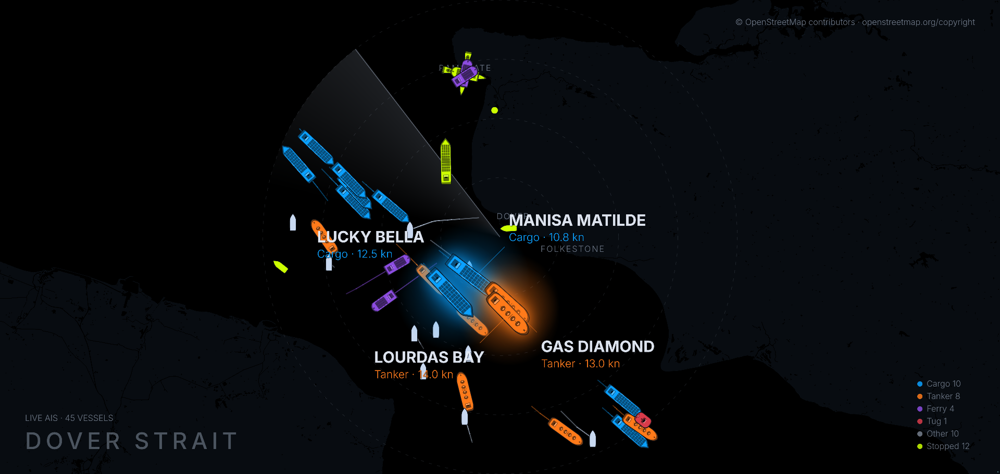

# Portsviews

The ships off your coast, live on your wall. Portsviews takes the position
reports that vessels broadcast continuously over public radio and draws them —
hull shape by vessel type, a wake behind each one, the largest ships named — on
any screen or projector you already own.

It is free and open source. There is no account, no subscription and nothing to
pay. You need one free API key and about ten minutes.



*A real frame from the display. The image is mirrored left-to-right, because the
display is designed to be bounced off a mirror onto a ceiling.*

## What you need

- **Node.js 20 or newer.** Check with `node --version`.
- **pnpm 9 or newer.** Install it with `npm install -g pnpm`. Alternatively,
  use `corepack enable && corepack prepare pnpm@latest --activate` — Corepack
  comes with Node. On Windows, enabling Corepack may require an administrator
  terminal.
- **A free AISstream.io API key.** Instructions below; it takes a minute and
  costs nothing.
- A screen. A projector is nicer, but any monitor works.

## Quick start

```bash
# 1. Get the code
git clone https://github.com/jlorow/portsviews.git
cd portsviews

# 2. Install dependencies
pnpm install

# 3. Put your free AISstream key in a .env file at the top level
# On Windows, use Notepad or your code editor instead of echo: older Windows
# PowerShell can save redirected files in a format the server cannot read.
echo "AISSTREAM_API_KEY=your-key-here" > .env

# 4. Start the data server (leave this running)
pnpm --filter @wake/server start

# 5. In a SECOND terminal, start the display
pnpm --filter display dev
```

If `pnpm install` reports ignored build scripts for esbuild, run
`pnpm approve-builds` and approve esbuild.

Then open **http://localhost:5173/** in a browser. Within a minute or two you
should see ships appear and start moving.

Two processes are needed and they do different jobs: the server holds the
connection to the AIS feed and passes positions on; the display draws them. The
display talks to the server over a WebSocket on port 8080, so start the server
first and leave it running.

The `.env` file must be at the **top level of the project**, beside
`package.json` — not inside `server/`.

## Getting a free AISstream key

AISstream.io broadcasts live ship positions to anyone who asks. It is free, and
you do not need to pay or enter a card.

1. Go to **https://aisstream.io** in your browser.
2. Create an account. An email address and a password is all it asks for.
3. Sign in, and find the section for API keys in your account.
4. Create a new key. It will look like a long string of letters and numbers.
5. Copy it, and paste it into your `.env` file after `AISSTREAM_API_KEY=`, with
   no quotes and no spaces around the `=`.

Your `.env` should end up looking like this, and nothing else is required:

```
AISSTREAM_API_KEY=abc123...
```

Keep that file to yourself. It is already listed in `.gitignore`, so git will
not commit it by accident.

**If the server says `AISSTREAM_API_KEY is missing or empty`**, it did not find
the file. Check that `.env` is at the top level and that the line has no leading
spaces.

## Choosing what you watch

Add `WAKE_AREA` to your `.env` to change the view. Four areas are built in:

| Value | What you see |
|---|---|
| `dover` | Dover Strait — the default, and the busiest shipping lane in Europe |
| `istanbul` | Sea of Marmara |
| `portsaid` | Port Said, at the northern end of the Suez Canal |
| `sydney` | Sydney Harbour |

```
WAKE_AREA=istanbul
```

Leave it out entirely and you get `dover`. A value that is not one of those four
makes the server refuse to start and tell you the valid list, rather than
starting on something you did not ask for.

## What you will see

Ships are drawn as hulls, coloured and sized by type — cargo, tanker, ferry,
naval, tug — with a wake trail behind each one showing where it has been. The
four largest moving vessels are drawn at full size with a glow and labelled with
their name, type and speed. Stopped vessels are drawn as dots. A slow radar
sweep reveals each vessel the first time it passes. There is a live count and a
legend in the corners.

**The coastline works out of the box.** The map layer under the ships — the
land, the water and the town names — ships with the repository for the default
`dover` area, so a fresh clone draws Kent and the Pas-de-Calais with no extra
setup and nothing to download. It is a 10 MB Protomaps archive at
`apps/display/public/tiles/dover-z11.pmtiles`, read straight off disk; the
display makes no request to any map service at runtime.

**The other three areas draw on plain black.** `istanbul`, `portsaid` and
`sydney` have no map archive of their own yet, so the ships, trails, labels and
legend all work there but there is no land underneath. Adding one is a Protomaps
`.pmtiles` extract dropped into the same folder plus a row in
`shared/src/basemap.ts`.

**Ships take a moment to appear.** Nothing is wrong if the screen is empty for
the first minute — the display only knows about a vessel once that vessel has
broadcast, and position reports arrive every couple of minutes per ship.

## The kit

Building this yourself means an evening of setup and a computer left running.
Not everyone wants that. A ready-made kit is coming — a small computer, a radio
receiver and antenna, and the software already installed and pointed at your
coast. Plug it in, point it at a wall, and it runs.

It does not exist yet. There is no price and no date, and it will be
crowdfunded publicly when it is real.

**Star or watch this repository** to hear about it — that is where the
announcement will go first.

## How it is put together

```
apps/display/   the renderer — React and a 2D canvas, drawn 60 times a second
server/         connects to the AIS feed, normalises messages, broadcasts them
shared/         the projection maths, vessel state and configuration both use
```

Tests are plain TypeScript run with `tsx`, with no test framework:

```bash
npx tsx shared/src/vesselState.test.ts
npx tsx apps/display/src/vesselTracker.test.ts
```

Type-check a package with `pnpm --filter display tsc --noEmit` or
`pnpm --filter @wake/server tsc --noEmit`.

## License

MIT. See [LICENSE](LICENSE).

Ship positions come from AISstream.io, whose terms are their own — check them
before doing anything commercial with the data. The bundled map data is
© OpenStreetMap contributors, made available by Protomaps under the Open
Database Licence.
